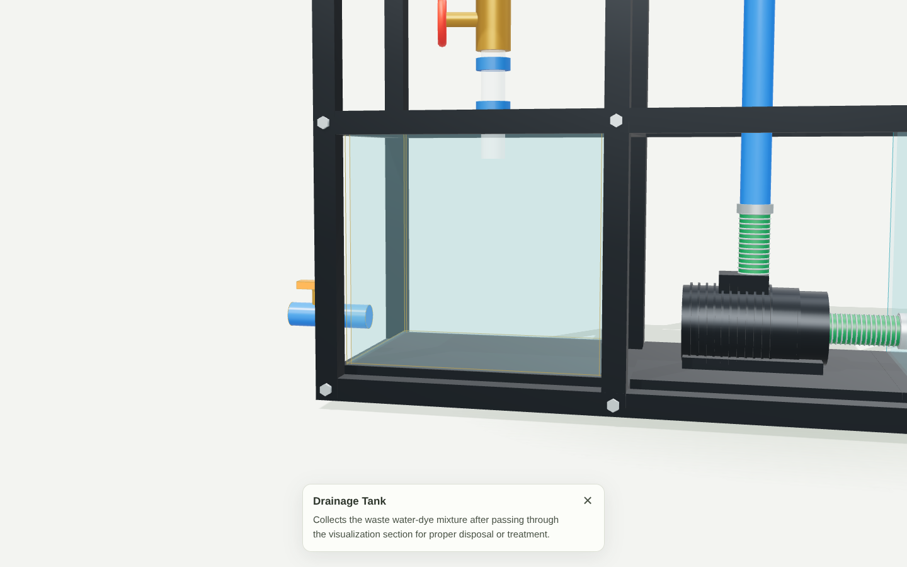
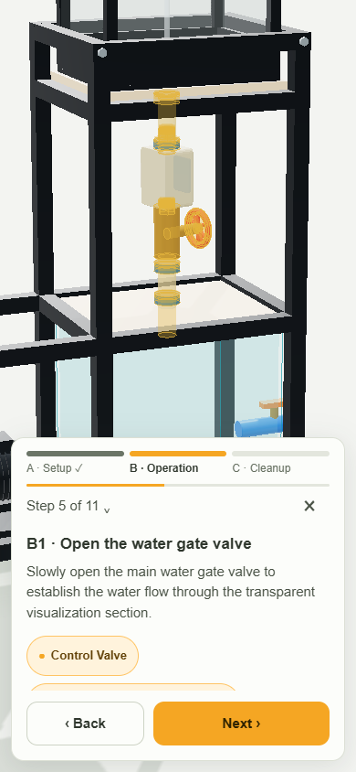
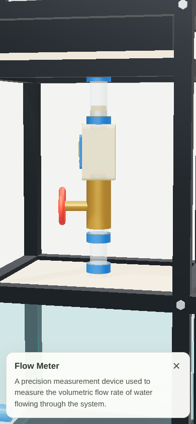

<div align="center">

<sub>BICOL UNIVERSITY · COLLEGE OF ENGINEERING</sub>

# Reynolds Apparatus

### From the laboratory bench to your browser.

Explore the apparatus in 3D. Get to know every part. Walk through the experiment, one step at a time.

**A fourth-year engineering student project at Bicol University.**

<p>
  
  
  
  
</p>

[Explore the features](#a-closer-look-at-the-lab) · [The walkthrough](#11-steps-one-guided-experience) · [Run locally](#take-it-for-a-spin)



<sub>The actual browser-rendered model, with a selected part and its description.</sub>

</div>

---

## A closer look at the lab

The Reynolds apparatus helps introduce how fluid flow is observed and studied in the laboratory. This project brings its components and operating procedure into an interactive browser experience, giving students a way to explore the equipment before working through the physical experiment.

| Feature | What you can do |
| :--- | :--- |
| **🔄 Explore in 3D** | Rotate around the assembly, zoom in, and inspect it from different angles. |
| **🔍 Meet the components** | Tap or click any of the eight documented parts to see its purpose. Small parts get a close-up; tanks stay in context. |
| **🟠 Follow the highlights** | Temporary amber overlays draw attention to the components involved in each step. |
| **🧭 Take the guided route** | Work through all 11 operating steps with camera framing, phase progress, and Back / Next controls. |
| **📋 Jump to a step** | Open the step list to navigate directly and see which steps you have visited. |
| **↩️ Pick up where you left off** | Resume saved progress or start over. |
| **📱 Use your own screen** | Explore with mouse controls on desktop or touch gestures on a phone. Keyboard shortcuts and reduced-motion support are included. |

## 11 steps. One guided experience.

The walkthrough follows the operating procedure in **“Reynolds Apparatus: Functions and Procedure.”** Each step connects an instruction to the relevant parts of the model.

| Phase | Steps | Focus |
| :--- | :---: | :--- |
| **A · Setup** | A1–A4 | Prepare the workspace, fill water and dye, start the pump, and establish a constant water head. |
| **B · Operation** | B1–B4 | Open the water valve, release the dye, adjust the flow regime, and read the flow rate. |
| **C · Cleanup** | C1–C3 | Top up the reservoir when needed, shut down, and drain the used mixture. |

You can inspect a highlighted part without losing your place. Return with **Back to step**, or open another component to leave the walkthrough and explore freely.

<div align="center">

<table>
  <tr>
    <th>Guided procedure</th>
    <th>Explore a component</th>
  </tr>
  <tr>
    <td align="center"></td>
    <td align="center"></td>
  </tr>
</table>

<sub>Screenshots from the running app.</sub>

</div>

## Know your apparatus

The model groups its components into the eight parts named in the project document:

| | Component | Role in the experiment |
| :---: | :--- | :--- |
| 01 | **Dye Injection Site** | Introduces the dye used to make flow patterns visible. |
| 02 | **Pipe for Dye** | Guides dye into the main water stream. |
| 03 | **Upper Water Tank** | Supplies water and supports a controlled flow head. |
| 04 | **Control Valve** | Regulates water flow and pressure at different points. |
| 05 | **Flow Visualization Pipe Section** | Provides the transparent section for observing flow behavior. |
| 06 | **Flow Meter** | Measures the volumetric flow rate. |
| 07 | **Lower Water Tank & Water Pump** | Stores and recirculates water through the system. |
| 08 | **Drainage Tank** | Collects the used water–dye mixture. |

## Take it for a spin

You will need **Node.js**, **npm**, and a browser with **WebGL** support.

```sh
git clone https://github.com/jrpbone-bu/O-Reynolds-Apparatus.git
cd O-Reynolds-Apparatus
npm ci
npm run dev
```

Open the local URL printed by Vite. Select **Start procedure** for the guided experience, or tap a part to explore it directly.

### Controls

| Action | Desktop | Mobile |
| :--- | :--- | :--- |
| Rotate | Drag with the left mouse button | Drag with one finger |
| Pan | Drag with the right mouse button | Move with two fingers |
| Zoom | Scroll | Pinch |
| Inspect a part | Click | Tap |
| Previous / next step | `←` / `→`, or the panel buttons | Back / Next buttons |
| Open the step list | `L`, or select the step counter | Tap the step counter |
| Exit the walkthrough | `Esc`, or the close button | Close button |

### Build for deployment

```sh
npm run build
npm run preview
```

Vite generates the production site in `dist/`, ready for static hosting.

## Under the hood

**Three.js** renders the model and handles camera interaction through OrbitControls. **Vite** serves the app and builds the production bundle. The interface uses plain **HTML, CSS, and JavaScript**, with no UI framework.

```text
src/
├── apparatus.js              # Procedural model and component groups
├── main.js                   # Viewer, selection, camera, and walkthrough
├── procedure.js              # The 11 steps and component mappings
└── style.css                 # Responsive interface
scripts/
├── check-groups.mjs          # Component grouping checks
├── snapshot-meshes.mjs       # Geometry, material, and transform signatures
├── check-parts.mjs           # Part-selection browser checks
└── check-procedure.mjs       # Walkthrough and interaction regression checks
```

<details>
<summary><strong>Run the verification checks</strong></summary>

Grouping and mesh signatures can be checked directly:

```sh
node scripts/check-groups.mjs
node scripts/snapshot-meshes.mjs
```

For browser checks, install Playwright's Chromium browser and keep the development server running on port `5173` in another terminal:

```sh
npx playwright install chromium
node scripts/check-parts.mjs
node scripts/check-procedure.mjs
```

Set `APP_URL` if the development server uses a different address. The procedure checks cover **390×844**, **360×640**, and **1440×900**, including camera framing, highlights, resume behavior, manual view preservation, and HTML consistency.

The scripts generate screenshots for review. The part-selection check rewrites the tracked images in `artifacts/part-focus/`; restore those after a check-only run with:

```sh
git restore artifacts/part-focus
```

</details>

---

<div align="center">

### Engineering concepts. A more hands-on way to explore them.

<strong>Fourth-Year Student Project</strong><br />
College of Engineering · Bicol University · Philippines

<sub>A visual model and procedure guide. Geometry is approximated from reference material; this is not a dimensionally validated model or a numerical fluid-flow simulation.</sub>

</div>
